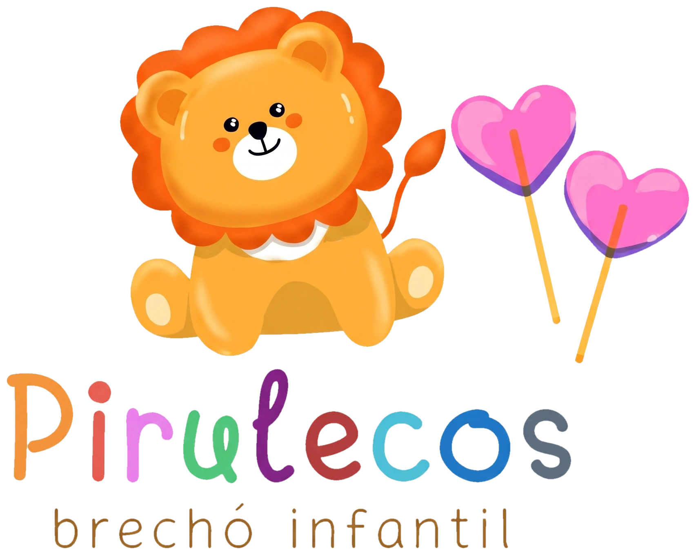

# Pirulecos · brechó infantil

Loja online da Pirulecos, um brechó infantil em que **cada peça é única**.



## Links

- **Protótipo no ar:** https://greghi-ai.github.io/pirulecos/
- **Telas (design):** https://claude.ai/artifact/1emumT97w1mJPCJEMpH23Z
- **Apresentação para a cliente:** https://claude.ai/artifact/GEfmPU3nCr1Ma1aBnez7LN

## O que o site faz

- Vitrine com filtro por tamanho (RN a 14 anos)
- Peça vendida aparece como **VENDIDO** sozinha quando o pagamento é aprovado
- Reserva de 15 minutos no carrinho, para ninguém comprar a mesma peça
- Pagamento por Pix e cartão (Mercado Pago)
- Frete PAC e SEDEX pelos Correios (Melhor Envio)
- Página de cupons: públicos e exclusivos para quem tem conta
- Conta da família com cadastro da criança (nome, tamanho, aniversário)
- Convite de cadastro que aparece **só na primeira visita**
- Painel no celular para a dona cadastrar as peças

Detalhes das regras e decisões: [docs/plano.md](docs/plano.md).

## Stack prevista

| Parte | Ferramenta |
|---|---|
| Site | Next.js (App Router) + TypeScript |
| Banco, login e fotos | Supabase (Postgres, Auth, Storage) |
| Pagamento | Mercado Pago (Pix + cartão, webhook) |
| Frete e etiquetas | Melhor Envio (Correios) |
| E-mails | Resend |
| Hospedagem | Vercel |

## Fases

1. **Lançamento:** vitrine, vendido automático, reserva, Pix/cartão, Correios, cupons, pop-up de primeira visita, painel de cadastro.
2. **Fidelização:** cadastro da criança, cupom de aniversário automático, aviso de peça no tamanho.
3. **Depois:** WhatsApp, entrega local/retirada, programa de pontos.

## Estrutura do repositório

```
assets/          logo e imagens da marca
design/telas/    telas do design (arquivos .dc.html do canvas)
apresentacao/    slides da proposta para a cliente
docs/            protótipo publicado no GitHub Pages + plano.md
```

O código do site entra em seguida, na raiz do repositório.

## Logo

Em `assets/`, todas com fundo transparente:

| Arquivo | Uso |
|---|---|
| `logo-pirulecos.png` / `.webp` / `.svg` | Logo completa |
| `logo-nome.*` | Só o nome, para o topo do site |
| `logo-leao.*` | Só o leão, para ícone e redes sociais |
| `logo-ilustracao.*` | Leão e pirulitos, sem o nome |
| `icone-32/180/192/512.png` | Favicon e ícone de celular |

O `.svg` é vetor: o nome fica perfeito em qualquer tamanho, e o leão fica com acabamento de ilustração chapada. Para o site, use `.webp`, que é mais leve e mantém o sombreado.

## Identidade visual

| Uso | Cor |
|---|---|
| Fundo creme | `#FFF9EF` |
| Texto (marrom) | `#3B2A1A` |
| Botão principal (laranja) | `#C65A0E` |
| Rosa | `#A42E5E` / fundo `#FCE1EC` |
| Amarelo leão | `#FFF1C2` |
| Azul | `#1F5F99` / fundo `#DCEBFA` |
| Verde | `#2B6E33` / fundo `#DFF2DA` |

Fontes: **Fredoka** (títulos) e **Nunito** (texto), do Google Fonts.
